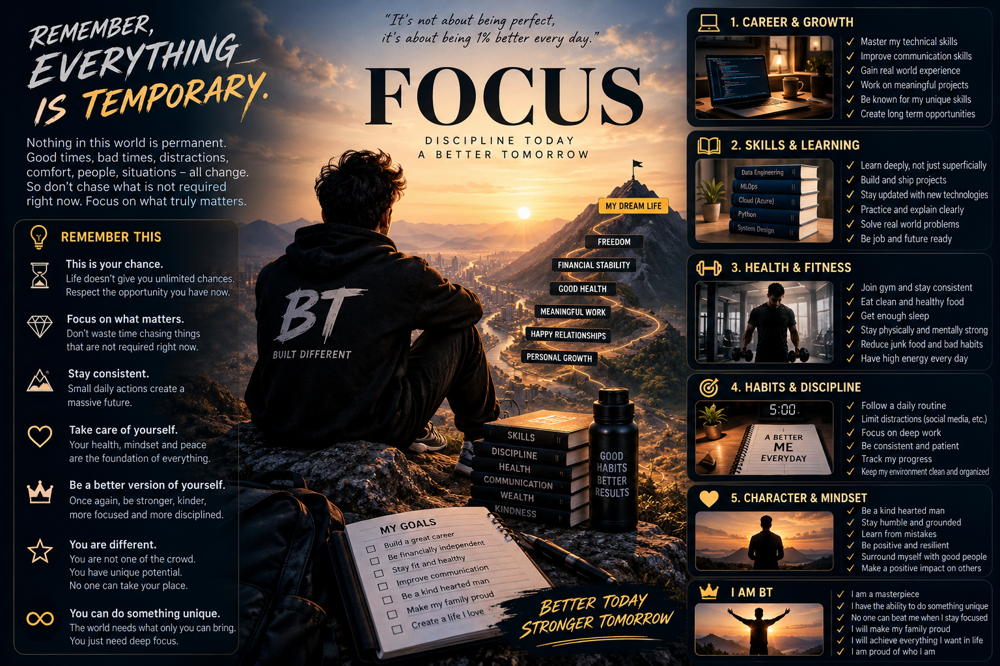

---

<!-- Intro -->
<h3 align="center">
  <samp>
    
    Hey There!, I am
    <b>Bhushan</b>
  </samp>
</h3>

  
   

<h3 align="center">🤖 An Aspiring MLOps Engineer from India, Focused on Production-Ready ML Systems</h3>

  
  
  
  
  

---

- 🔭 Building end-to-end **Machine Learning and MLOps pipelines** with automated training, evaluation, and deployment.
- 🌱 Learning and implementing **MLflow, model versioning, experiment tracking, and model lifecycle management**.
- ⚙️ Working with **Docker, GitHub Actions, CI/CD, and Databricks Asset Bundles** to automate ML workflows.
- 📊 Exploring **feature engineering, model monitoring, batch inference, and production ML systems**.
- 🎯 Focused on building scalable, reproducible, and reliable machine learning solutions.

---

<h3 align="left">Connect with me:</h3>

  
  

### Skills

  
  
  
  
  
  
  
  
  
  
  

### 📊 My GitHub Stats

  <table>
    <tr>
      <td>
        
      </td>
      <td>
        
      </td>
    </tr>
    <tr>
      <td>
        
      </td>
      <td>
        
      </td>
    </tr>
  </table>

🎯 **My Focus. My Future. My Journey.**

  

  

---
